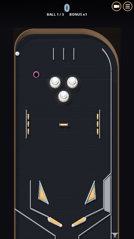
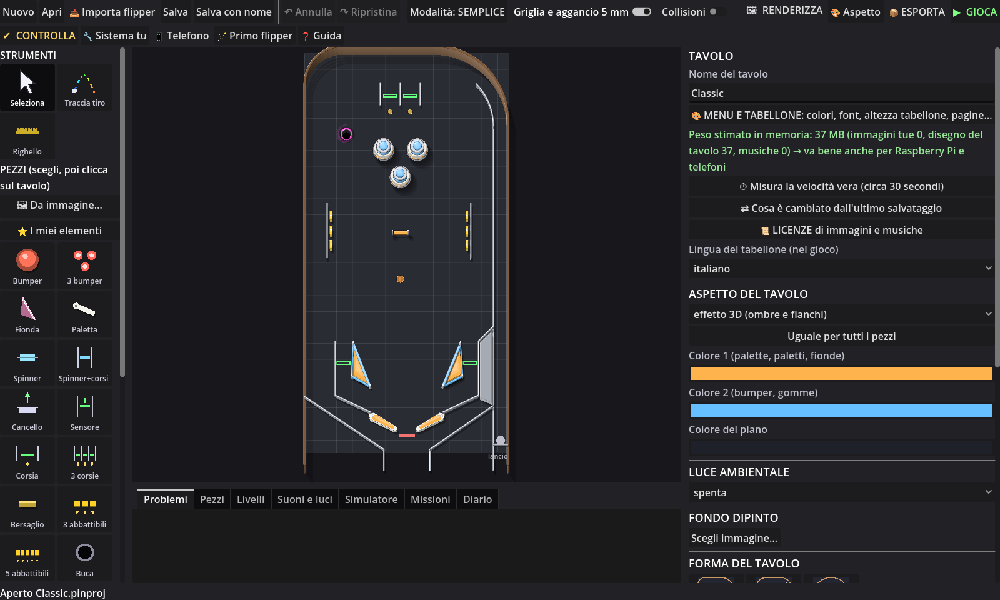
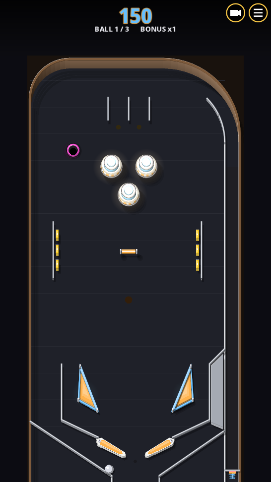

# Pinball Editor 2D

> *An open source 2D pinball editor, built by the community, for the community.*

**Created by Carmelo Vadalà** · Open Source Community Project · contact: themeloohgames@gmail.com

Pinball Editor 2D lets anyone build a real, playable 2D pinball table **with the mouse**, without programming:
draw the table, place bumpers, ramps, targets, flippers and raised playfields, write missions with ready-made
"bricks", choose lights, sounds and colours, test it with the real physics engine, then export it for PC,
Raspberry Pi and Android — or release it officially together with its public source code.

<p align="center">
  
</p>



| The game | Promo video |
|---|---|
|  | [▶ Watch `promo.mp4`](docs/media/promo.mp4) (30 s, no audio): the *Classic* example table, recorded with the editor's own promo-video export. |


## Highlights
- Visual editor: walls and curves by points, ramps and wire ramps with height, wide "ribbon" lanes, raised
  playfields reached by ramps or holes, captive ball, scoops, diverters, gates, drop targets, spinners, kickbacks.
- Real physics (Godot 4, 240 steps/s, continuous collision), measurements in millimetres.
- Missions with bricks (count, all, sequence, combo, hurry-up, keep alive, energy), modes with priority, secret
  goals, top-10 high score table with initials, light shows, attract mode.
- Your own images on every piece (the collision stays adjustable), fonts, themes, phone preview.
- Checks: dangerous gaps, stuck-ball hunt, shot tracing, heat map, "fix it for me", real speed measurement.
- Guided "first pinball" wizard, ready-made groups, built-in guide (F1).
- Export: test builds (PC, Raspberry Pi 4, Android), full Godot project, promo video, and the
  **official release** (game + public source + licences + credits + AI instructions).

## Download
Ready-to-use packages for **Windows** and **Linux** are in the [Releases](../../releases) page: unzip and
double-click *Pinball Editor 2D*. Games can be exported for **Windows, Linux, Raspberry Pi and Android**
(macOS and iPhone: contributions welcome, see [`docs/PLATFORMS.md`](docs/PLATFORMS.md)).

## From source
1. **Godot 4.7.2** (free): https://godotengine.org. The export templates are installed from the editor
   (📦 ESPORTA → *Installa i modelli di esportazione*).
2. Clone this repository, then start the editor:
   ```bash
   godot --path . res://editor/editor.tscn
   ```
   or `./avvia_editor.sh` (uses `godot` from your PATH or the `GODOT` environment variable).
   Opening the project in Godot and pressing F5 runs the **game** with the base table.
3. Guides: [`docs/USER_GUIDE.md`](docs/USER_GUIDE.md) (English, quick start) and the full manual in Italian,
   [`docs/MANUALE.md`](docs/MANUALE.md), also inside the editor (❓ Guida, F1).

**Language:** the editor interface is in Italian for now. An English interface is the first thing we would love
help with — see [`CONTRIBUTING.md`](CONTRIBUTING.md).

## Licences
| What | Licence |
|---|---|
| Editor and game runtime code | **GNU GPL v3.0 or later** (`LICENSE`) |
| Original creative content of a pinball (graphics, music, texts, table design) | **CC BY-SA 4.0** |
| Third-party resources | their own licence, listed in [`CREDITS.md`](CREDITS.md) and `LICENSES/` |

Pinballs made with the editor can be **sold**, put in **cabinets**, modified and redistributed — and so can
everybody else's versions of them: whoever receives a pinball keeps the right to get its source code, modify it
and share it. The official release flow of the editor publishes every released pinball's source code publicly.
Details: [`docs/LICENSING.md`](docs/LICENSING.md) and [`docs/RELEASE.md`](docs/RELEASE.md).

## Contributing
Bug reports, ideas and pull requests are welcome: read [`CONTRIBUTING.md`](CONTRIBUTING.md) and the
[`CODE_OF_CONDUCT.md`](CODE_OF_CONDUCT.md). Every change to the official version goes through a pull request,
automatic tests and review. Forks are welcome too, as the licence allows.

---

---
Created by Carmelo Vadalà · Built by the community, for the community.
